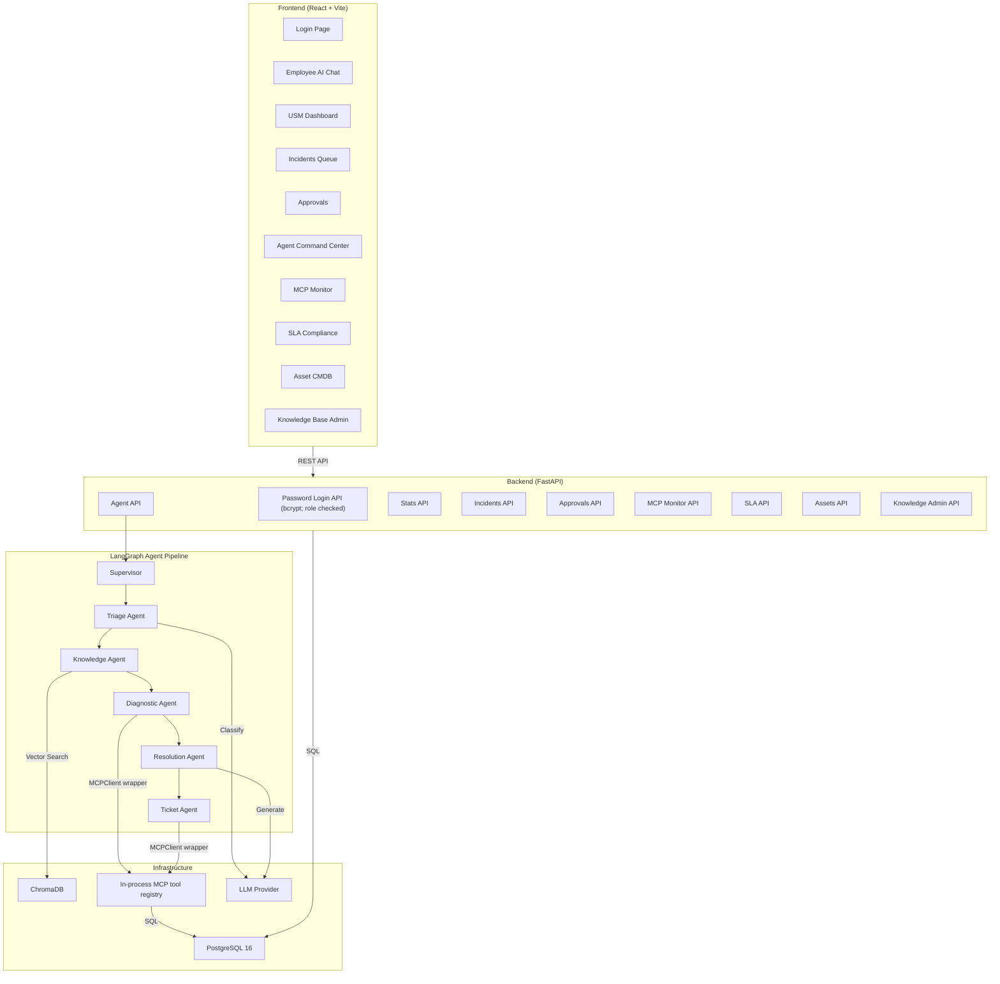
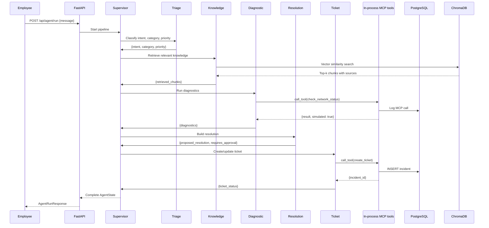
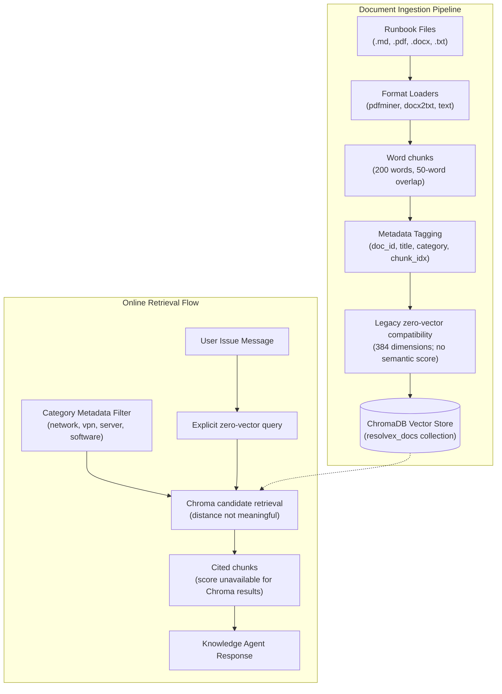
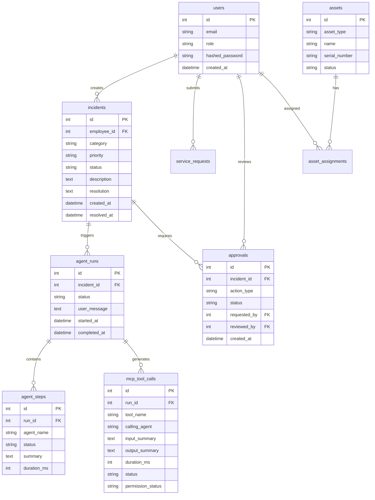
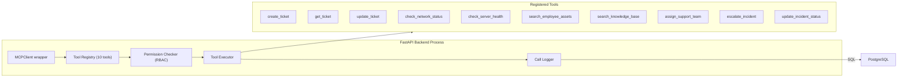

# ResolveX AI – Architecture

> Multi-agent autonomous USM platform architecture documentation.

## System Overview

## Agent Pipeline Flow

## RAG Pipeline Architecture

When Chroma is unavailable or returns no candidates, retrieval falls back to local lexical overlap and labels that score method explicitly. RAG administration exposes actual chunks, citations, measured latency, and score availability. Moving to semantic embeddings requires a separate, validated re-embedding plan; existing vectors are not replaced here.

## Data Model (ER Diagram)

## MCP Tool Execution (Current Runtime)

The application backend currently calls the registered tools in-process; `/api/mcp/status` reports `in_process`. The separate Streamable HTTP endpoint is not yet used by agent or API calls. MCP call rows persist tool, calling agent, incident/run/user correlation, duration, status, and permission result.

## Technology Stack

| Layer | Technology | Purpose |
|-------|-----------|---------|
| Frontend | React 18 + TypeScript + Vite | SPA with modern tooling |
| Styling | Tailwind CSS | Utility-first responsive design |
| Charts | Recharts | Dashboard data visualization |
| Agent Graph | React Flow | Visual agent handoff diagram |
| State Mgmt | TanStack React Query | Server state + caching |
| Backend | FastAPI + Python 3.11 | REST API with auto-docs |
| ORM | SQLAlchemy 2.x + Alembic | Type-safe DB access + migrations |
| Auth | JWT bearer tokens + bcrypt | Protected API routes enforce role permissions; employees are scoped to their own records |
| Agents | LangGraph | Typed state graph with checkpointing |
| MCP | Official `mcp` Python SDK | In-process tool registry and execution wrapper; standalone HTTP client integration remains a known gap |
| RAG | ChromaDB + legacy zero-vector compatibility | Candidate retrieval plus labeled lexical fallback; meaningful Chroma similarity scores are unavailable |
| Database | PostgreSQL 16 | Relational data store |
| Infra | Docker Compose | Multi-container orchestration |
| Testing | pytest + Vitest | Backend + frontend test suites |

